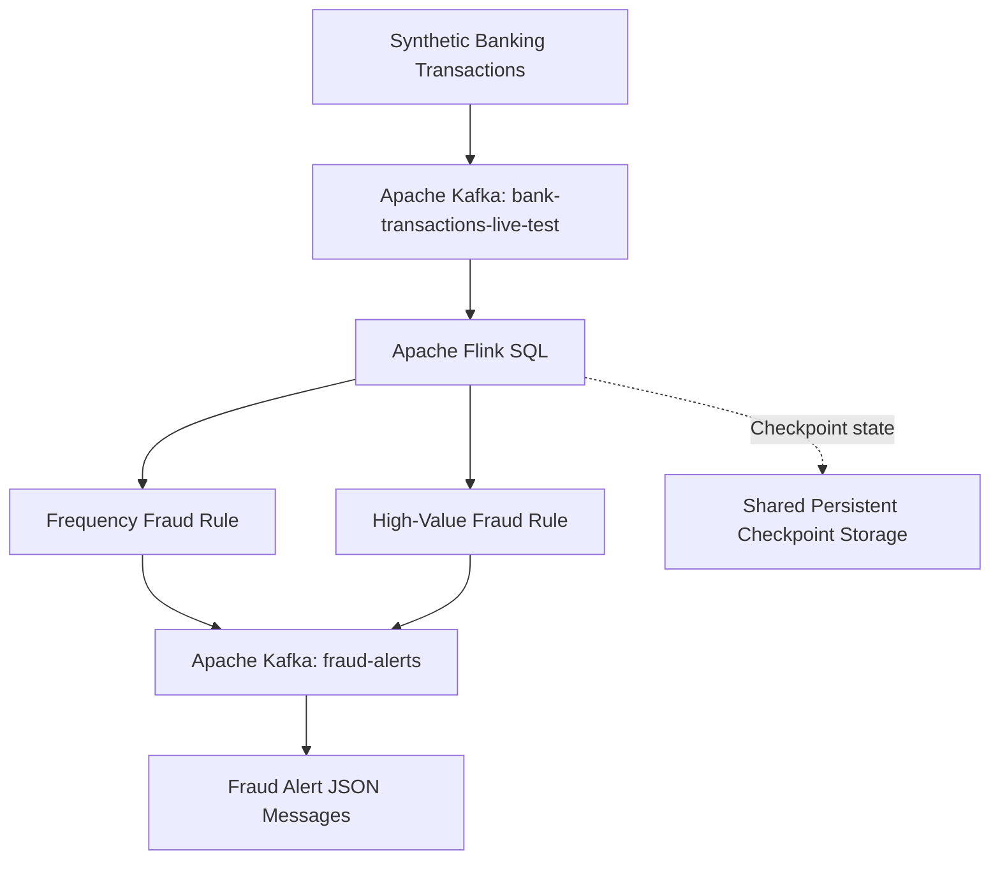

# Real-Time Bank Fraud Detection using Kafka and Apache Flink

## Project Overview

A local streaming data engineering demonstration that processes
synthetic banking transactions, detects suspicious activity using
Apache Flink SQL, and publishes alerts to Apache Kafka.

This project is a learning/portfolio demonstration using synthetic
transactions, not a production banking deployment.

## Technology Stack

- Apache Kafka 7.9.0 (Confluent image)
- Apache Flink 1.20.1
- Flink SQL
- Docker and Docker Compose
- Kafka SQL Connector
- Persistent Flink checkpoints

## Architecture



## Fraud Detection Rules

### 1. Frequent Transaction Alert

- Uses a 5-minute tumbling event-time window
- Generates FREQUENT_TRANSACTION_ALERT when transaction count >= 3
- Current demo SQL filters to account ACC888

### 2. High-Value Window Alert

- Uses a 5-minute tumbling event-time window
- Generates HIGH_VALUE_WINDOW_ALERT when total amount >= 2000
- Applies to all account IDs in the source stream

Both rules use a 5-second event-time watermark.

## Kafka Topics

Input: bank-transactions-live-test

Output: fraud-alerts

## Checkpointing and Recovery

The deployment configures:

- Checkpoint interval: 30 seconds
- Flink checkpoint mode: EXACTLY_ONCE
- Filesystem checkpoint storage
- Shared persistent Docker volume

A controlled TaskManager restart was performed.

Observed results:

- Both Flink jobs returned to RUNNING
- Both jobs restored from checkpoint #31
- Job 1: 40 completed checkpoints, 0 failed
- Job 2: 46 completed checkpoints, 0 failed

These counts are observations from 21 November 2026.

Checkpoint evidence:

- docs/evidence/job1-checkpoints.json
- docs/evidence/job2-checkpoints.json

Checkpoint recovery does not by itself establish
end-to-end duplicate-free Kafka alert delivery.

## Important Project Files

- docker-compose.yml
- docker-compose.checkpoints.yml
- project-backup/recovery-tables.sql
- project-backup/frequency-alert.sql
- project-backup/high-value-alert.sql
- project-backup/deploy-with-checkpoints.sql
- docs/evidence/

## Local Setup Notes

The Kafka SQL Connector JAR is stored locally in
flink-connectors/ and mounted into both Flink containers.

Start services using both Compose configuration files:

```bash
docker compose \
  -f docker-compose.yml \
  -f docker-compose.checkpoints.yml \
  up -d
```

The checkpoint volume must be writable by the Flink process.

SQL table definitions use the default in-memory catalog,
so a fresh SQL session needs table definitions recreated.

Deploy the saved SQL only when equivalent streaming jobs
are not already running. Repeated submission can create
duplicate jobs and exhaust TaskManager slots.

Do not use docker compose down -v if you need to preserve
local Docker volumes.

## Limitations

- Synthetic test transactions
- Local single-broker Kafka environment
- No production security or access-control configuration
- No confirmed end-to-end deduplication guarantee
- No production fraud model or financial risk calibration
- Kafka connector JAR must be available locally

## Interview Takeaway

Demonstrates Kafka ingestion, event-time stream processing,
SQL window aggregations, fraud alert generation, persistent
checkpointing, Flink job monitoring, troubleshooting and
checkpoint-based recovery.
